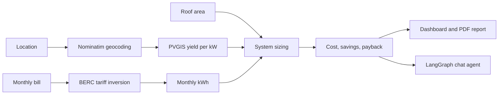

Enter your location, monthly electricity bill and roof area. Bangla Solar AI works out the right system size, expected generation, cost, bill savings and payback, then lets you ask follow-up questions to an AI assistant and download a PDF report.

> **Disclaimer:** All results are preliminary estimates, not quotations or guarantees. Consult a qualified solar professional before installation.

---

## Highlights


|                          |                                                                                                                              |
| ------------------------ | ---------------------------------------------------------------------------------------------------------------------------- |
| **Location-aware yield** | Geocodes any place in Bangladesh (OpenStreetMap Nominatim) and pulls per-kW generation from the European Commission's PVGIS. |
| **Real tariff maths**    | Uses the BERC residential slab tariff (June 2026, 5% VAT) to turn your bill into kWh, and to price savings slab by slab.     |
| **Roof-aware sizing**    | Sizes the system to your consumption, capped by usable roof area.                                                            |
| **Battery backup**       | Optional battery sizing from load, duration, depth of discharge and inverter efficiency.                                     |
| **AI assistant**         | A LangGraph agent with tool calling, grounded in your current assessment, with "what-if" support.                            |
| **Bilingual PDF report** | English or বাংলা, rendered with Noto Sans Bengali and proper text shaping.                                              |

---

## How it works



---

## Quick start

```bash
git clone https://github.com/SilverShadow123/Bangla-Solar-AI.git
cd Bangla-Solar-AI

python -m venv venv
source venv/bin/activate          # Windows: venv\Scripts\activate

pip install -r requirements.txt
pip install uharfbuzz             # needed for Bangla text shaping in the PDF
```

Create a `.env` file in the project root:

```env
OPENROUTER_API_KEY=your_openrouter_api_key
OPENROUTER_MODEL=your_model_id
```

The model must support tool (function) calling.

Run the app:

```bash
streamlit run app.py
```

The Noto Sans Bengali fonts used for the PDF live in `assets/fonts/` (`NotoSansBengali-Regular.ttf` and `NotoSansBengali-Bold.ttf`).

---

## Usage

1. In the sidebar, enter your **location**, **monthly bill (BDT)** and **roof area (m²)**.
2. Optionally enable **battery backup** and set the load and duration.
3. Pick the report language and click **Assess Solar Potential**.
4. Review the results and download the PDF.
5. Ask the assistant follow-ups, for example:
   - *What if my roof were 80 m²?*
   - *How much would 3 kW generate in Rajshahi?*
   - *What battery do I need for a 1 kW load for 6 hours?*

---

## Project structure

```
.
├── app.py                 Streamlit app
├── agent/                 LangGraph agent, LLM client, prompts
├── services/              Assessment engine, agent runner, report and PDF generation
├── tools/                 Calculation tools (tariff, sizing, yield, cost, economics, battery)
├── assets/fonts/          Noto Sans Bengali fonts for the PDF
├── tests/                 Test suite
├── evals/                 Evaluations
├── data/  database/       Project data
└── requirements.txt
```

Run the tests with:

```bash
pytest
```

---

## Default assumptions


| Item                       | Value                                                                |
| -------------------------- | -------------------------------------------------------------------- |
| Tariff                     | BERC residential slabs, June 2026 (lifeline 0–50 units at 4.63 BDT) |
| VAT                        | 5%                                                                   |
| Usable roof                | 70% of roof area                                                     |
| Panel area                 | 5.5 m² per kW                                                       |
| PVGIS system loss          | 14%                                                                  |
| Solar cost                 | 80,000 BDT per kW (illustrative)                                     |
| Battery cost               | 30,000 BDT per kWh (illustrative)                                    |
| Battery depth of discharge | 80%                                                                  |
| Inverter efficiency        | 90%                                                                  |
| Exported surplus           | No cash value (conservative)                                         |

Update the tariff in `tools/tariff.py` whenever BERC publishes a new order. Cost defaults are in `tools/cost_estimation.py`.

---

## Limitations

- Shading, orientation, tilt and structural suitability are not assessed.
- Monthly generation is the annual figure divided by 12, not a seasonal forecast.
- Consumption is inferred from the bill; demand charges and other fees are ignored.
- Payback ignores tariff changes, panel degradation, maintenance, financing and battery replacement.
- Equipment prices are illustrative, not current market quotes.

---

## Built with

[Streamlit](https://streamlit.io/) · [LangGraph](https://langchain-ai.github.io/langgraph/) · [LangChain](https://python.langchain.com/) · [OpenRouter](https://openrouter.ai/) · [PVGIS](https://re.jrc.ec.europa.eu/pvg_tools/en/) · [Nominatim](https://nominatim.org/) · [fpdf2](https://py-pdf.github.io/fpdf2/)

## License

No license has been specified yet. Add one to clarify how others may use this project.
